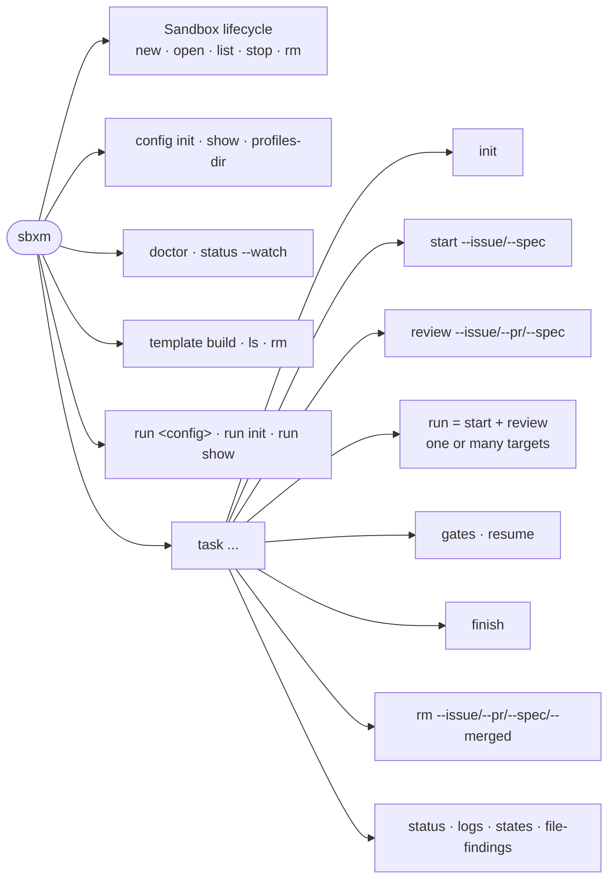
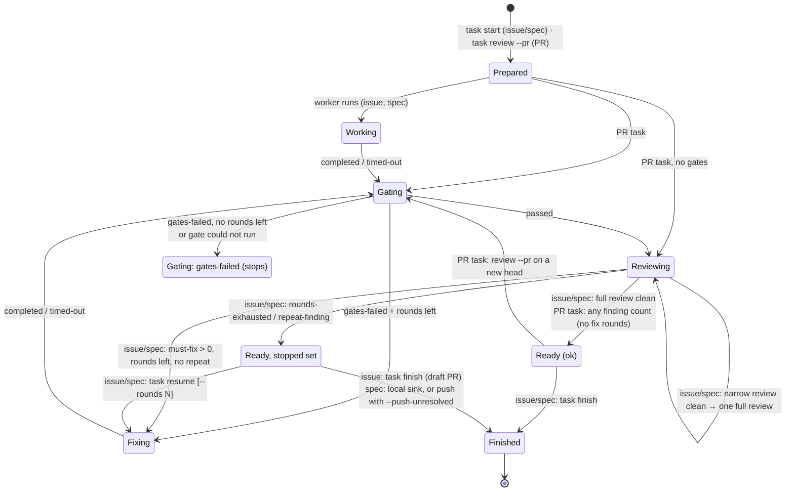
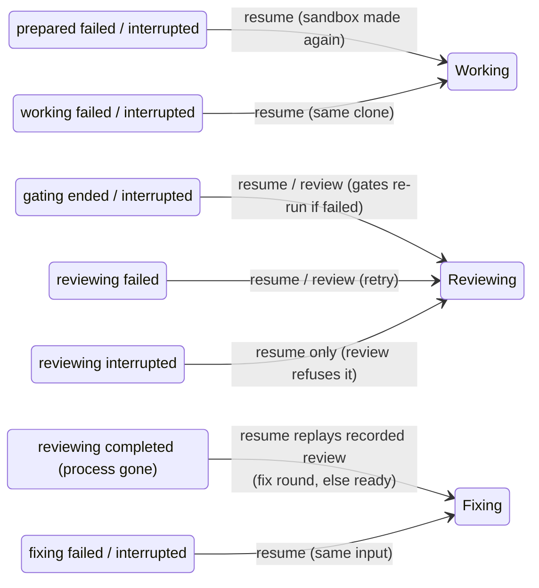
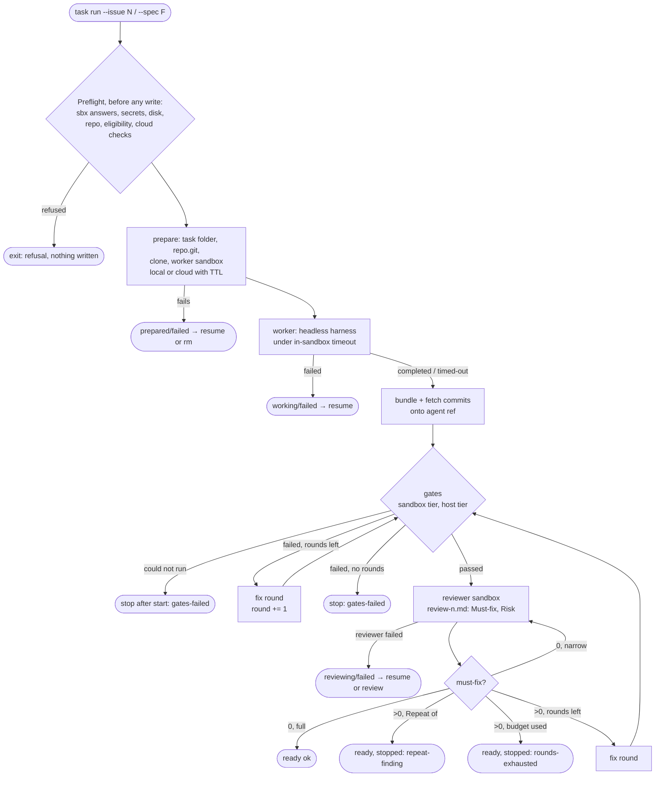
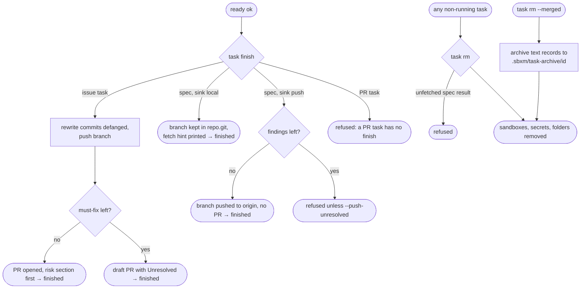
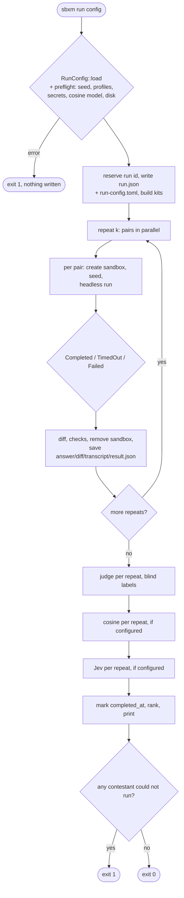

# sbxm state diagrams

Drawn from the code on `main` (a8ee1f1), 2026-11-02. Sources: `src/cli.rs`, `src/task/machine.rs` (the
task state table), `src/task/record.rs`, `src/task/pipeline.rs`, `src/commands/*.rs`. `sbxm task states`
prints the task table itself.

## 1. Invocations



Read-only (no state change): `list`, `config show`, `config profiles-dir`, `doctor`, `status`,
`template ls`, `run show`, `task status`, `task logs`, `task states`.

## 2. Sandbox lifecycle (`new`, `open`, `stop`, `rm`)

```mermaid
stateDiagram-v2
  [*] --> Checks: new / open (no sandbox)
  Checks --> Refused: bad name, exists, low disk,<br/>missing secret, strict template refusal
  Checks --> KitBuilt: template::choose → tag or install kit
  KitBuilt --> Refused: validate_kit fails
  KitBuilt --> Running: sbx create, state.json written
  Running --> Attached: open (hash matches)
  Attached --> Running: detach
  Running --> Drifted: config hash changed
  Drifted --> Refused: open without --rebuild
  Drifted --> KitBuilt: open --rebuild (old removed only after new kit validates)
  Running --> Stopped: stop
  Stopped --> Attached: open
  Running --> Removed: rm
  Stopped --> Removed: rm
  Removed --> Purged: rm --purge + confirm (workspace deleted)
  Refused --> [*]
  Removed --> [*]
  Purged --> [*]
```

## 3. Task record: stage × status (`src/task/machine.rs`)

Every stage carries a status: `prepared` {running, failed}; `working`/`fixing` {running, completed,
timed-out, failed}; `gating` {running, passed, gates-failed}; `reviewing` {running, completed, failed};
`ready`/`finished` {ok}. "Interrupted" = `running` whose recorded process (pid + start time) is gone.



Failure and resume (issue/spec tasks; `task resume`):



`task gates` re-runs gates from `working`/`fixing` done or any ended `gating`. `task rm` is allowed from
any state that is not running (or running but interrupted). Issue and spec tasks have no dead ends
(`tests/task_machine.rs`). A PR task has four, where only `rm` then `review --pr` again moves on:
prepared/failed, gating interrupted, reviewing interrupted, reviewing completed (issue #379).

## 4. `task run` / `task review` processing (issue or spec)



A cloud task's worker sandbox and its scoped secrets are removed whenever the task stops. A list
`task run` runs targets in order; only `sbx` not answering, a missing secret, low disk or `exec`
itself failing stops the whole list (decision 193).

## 5. Completion: `task finish` and `task rm`



## 6. Comparison run (`sbxm run <config>`)



Timed-out pairs keep their partial output and are still evaluated.

## 7. Templates (`template build`)

```mermaid
stateDiagram-v2
  [*] --> Checks: template build (claude, codex, pi; sbx >= 0.46.0)
  Checks --> Refused: unsupported harness, old sbx, build lock held
  Checks --> Building: baked kit, optional --warm
  Building --> Recorded: tag saved, record JSON written
  Recorded --> Recorded: previous tag cleaned up
  Recorded --> Used: new/open/task/run choose the tag
  Recorded --> Removed: template rm (refused while users record it)
  Refused --> [*]
  Removed --> [*]
```


